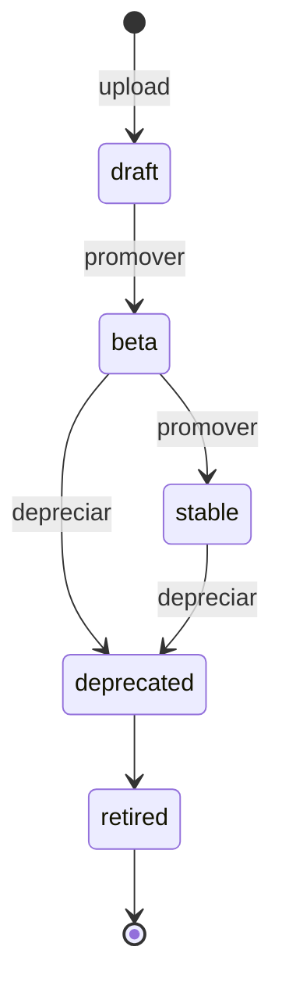
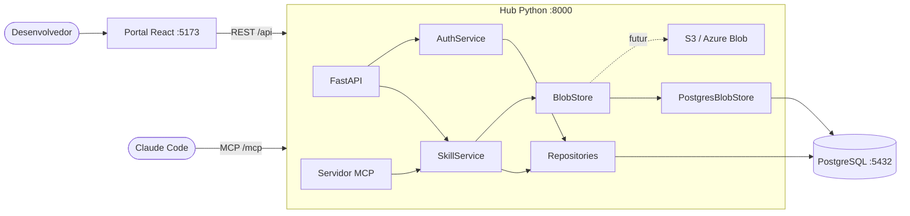

# Skills Hub (POC)

Repositório central e versionado de skills de IA, servido por MCP. Um desenvolvedor envia uma skill pelo portal, o hub valida, versiona e guarda; depois a skill aprovada (`stable`) é lida pelo Claude Code via MCP, com o hash do conteúdo conferido.

Esta é uma prova de conceito que roda 100% local (Docker Compose) e foi desenhada para evoluir para a nuvem sem reescrita.

## Como funciona

1. **Upload:** no portal, o dev envia um `SKILL.md` ou um `.zip` com a versão (semver). A skill entra como `draft`.
2. **Governança:** a versão é promovida `draft → beta → stable` e pode ser depreciada. Versões publicadas nunca são sobrescritas; corrigir é publicar outra versão. Tudo gera registro de auditoria.
3. **Consumo:** o Claude Code conecta no servidor MCP e lê as skills `stable` (ou `beta`, se pedido). Cada arquivo vem com o digest SHA-256, e o hub confere o hash ao ler.

### Ciclo de vida de uma versão



Qualquer outra transição devolve erro 409. Os canais `beta` e `stable` apontam para a versão promovida, e a promoção atualiza versão, canal e auditoria na mesma transação.

## Arquitetura

O desenho oficial é mantido como código em [`docs/arq.c4`](docs/arq.c4) (LikeC4). Visão geral:



### Camadas do hub

```
api/ e mcp/  -->  service/  -->  store/ (BlobStore) e repositories/
```

- `api/` (REST) e `mcp/` (MCP) são adaptadores finos: não acessam banco nem blobs direto.
- Toda regra de negócio fica em `service/`: `SkillService` (skills) e `AuthService` (login, sessões e tema).
- Só `repositories/` fala SQL, e só implementações de `BlobStore` gravam e leem conteúdo.
- Camadas inferiores nunca importam as superiores. O portal fala apenas com a API REST.

### BlobStore: o ponto de troca para a nuvem

`BlobStore` é uma interface (`put`, `get`, `exists`) com endereçamento por conteúdo: a chave é o SHA-256, gravar o mesmo conteúdo duas vezes não duplica, e `get` sempre recalcula o hash e levanta erro de integridade se divergir. Na POC a implementação é o `PostgresBlobStore`; trocar por `S3BlobStore` ou `AzureBlobStore` só exige novo adaptador, e há testes de contrato que qualquer implementação deve passar.

### Modelo de dados

| Tabela | O que guarda |
|---|---|
| `skills` | Nome (único), domínio e dono |
| `skill_versions` | Versão semver, status, frontmatter (`jsonb`), hash do pacote e autor |
| `skill_version_files` | Caminho, SHA-256 e tamanho de cada arquivo da versão |
| `channels` | Qual versão está em `beta` e em `stable` |
| `blobs` | Conteúdo dos arquivos, chaveado pelo SHA-256 |
| `audit_events` | Quem fez o quê, em qual skill e versão (uploads, promoções e leituras pelo MCP) |
| `users` e `auth_sessions` | Usuários (senha com `scrypt`, tema por usuário) e sessões de login |

### Imutabilidade imposta pelo banco

O hub conecta com um usuário de permissões mínimas: `blobs`, arquivos e auditoria só aceitam `INSERT` e `SELECT`; `skill_versions` só atualiza a coluna `status`; `channels` só atualiza `version_id`; não existe `DELETE` em lugar nenhum. As migrações rodam com outro usuário, dono do esquema. Isso é coberto por testes de integração.

## Servidor MCP

- Transporte Streamable HTTP em `/mcp`, com o SDK oficial `mcp` (sem FastMCP) e a extensão de Skills (SEP-2640).
- Métodos `skills/list`, `skills/get` e `resources/read`, com URIs `skill://<nome>/SKILL.md` e `skill://<nome>/<caminho>`.
- Cada skill é listada com os arquivos, o digest SHA-256 e o tamanho de cada um.
- Por padrão serve só `stable`; o canal `beta` é pedido de forma explícita.
- Para clientes sem a extensão há tools de fallback: `list_skills` e `get_skill`.
- Toda entrega de skill gera um evento de auditoria.

## API REST

Rotas em `/api` (todas, menos saúde e login, exigem sessão):

| Método | Rota | Função |
|---|---|---|
| GET | `/api/health` | Saúde do hub |
| POST | `/api/auth/login`, `/api/auth/logout` | Entrar e sair |
| GET | `/api/auth/me` | Usuário logado |
| PUT | `/api/auth/theme` | Guarda o tema claro ou escuro |
| POST | `/api/skills/upload` | Upload de `.md` ou `.zip` com a versão |
| GET | `/api/skills` | Lista skills com descrição, canais e status |
| GET | `/api/skills/{name}` | Detalhe e versões |
| GET | `/api/skills/{name}/versions/{version}` | Arquivos e hashes |
| POST | `/api/skills/{name}/versions/{version}/promote` | Promove para `beta` ou `stable` |
| POST | `/api/skills/{name}/versions/{version}/deprecate` | Deprecia |

Erros vêm em JSON com `code` e `message`. A documentação interativa está em `/docs` (Swagger) e a referência do MCP em `/mcp-docs`.

## Portal

Visual zinc e indigo, com tema claro e escuro e rotas por hash. Telas:

- **Login:** card centralizado; sem sessão, qualquer rota mostra o login.
- **Skills:** busca por nome, filtros de domínio e status, tabela no desktop e cards no celular, com descrição e badges `stable` e `beta`.
- **Detalhe:** versões, arquivos com hash (copiar ao clicar), botões Promover e Depreciar.
- **Enviar skill:** arrastar e soltar `.md` ou `.zip`, versão semver com sugestão de correção e erros reais da API.

Menu do usuário na navbar (o "Sair" aparece ao passar o mouse ou clicar no ícone) e links de API e MCP no rodapé. Responsivo, sem rolagem horizontal em 375 px.

## Validação de upload

`SKILL.md` obrigatório na raiz; frontmatter com `name` (minúsculas, números e hífens) e `description`; limites configuráveis de tamanho e quantidade de arquivos; `.zip` rejeita caminhos absolutos, `..`, links simbólicos e arquivos fora da pasta da skill. O conteúdo enviado é tratado como dado não confiável e nunca é executado.

## Como rodar

Pré-requisito: Docker com Docker Compose. Nada da aplicação roda direto na máquina.

```bash
cp .env.example .env     # ajuste os valores se quiser
docker compose up --build
```

- Portal: <http://localhost:5173>
- API e Swagger: <http://localhost:8000/api> e <http://localhost:8000/docs> (também pelo portal)
- MCP: `http://localhost:8000/mcp`

O hub aplica as migrações do banco ao iniciar. O usuário inicial do portal é criado pela migração (veja `hub/alembic/versions/`); **é só para ambiente local, troque antes de expor o portal**. Para acessar pelo celular, use `http://<IP do computador>:5173` na mesma rede.

### Conectar o Claude Code ao MCP

```bash
claude mcp add --transport http skills-hub http://localhost:8000/mcp
```

### Testes e qualidade

```bash
docker compose run --rm hub-test pytest          # hub
docker compose run --rm hub-test ruff check .    # lint
docker compose run --rm hub-test mypy src        # tipos
docker compose run --rm portal npm test          # portal
```

## Estrutura

```
hub/        API REST, servidor MCP, regras de negócio, BlobStore e migrações
portal/     Interface React
examples/   Skills de exemplo
scripts/    Demonstração e verificação de hashes pelo MCP
docs/       Arquitetura (arq.c4), especificações e tarefas
CLAUDE.md   Regras detalhadas do projeto
```

## Documentação

Regras, modelo de dados, API e decisões: [`CLAUDE.md`](CLAUDE.md) e [`docs/README.md`](docs/README.md).

## Evolução prevista

| POC | Versão final |
|---|---|
| Portal local | Portal na nuvem, atrás de SSO |
| Um contêiner `hub` | Contêineres separados, com autoscaling |
| `PostgresBlobStore` | `S3BlobStore` ou `AzureBlobStore` imutável |
| PostgreSQL no Docker | PostgreSQL gerenciado |
| Upload direto | Pipeline com scan, evals e assinatura |
| Login local | SSO corporativo (OAuth) |
| Docker Compose | ECS ou Container Apps, via Terraform |

## Fora do escopo da POC

SSO, cadastro e troca de senha, login no MCP, adaptadores S3 e Azure, pipeline de CI com scan e assinatura, e multi-tenant.
